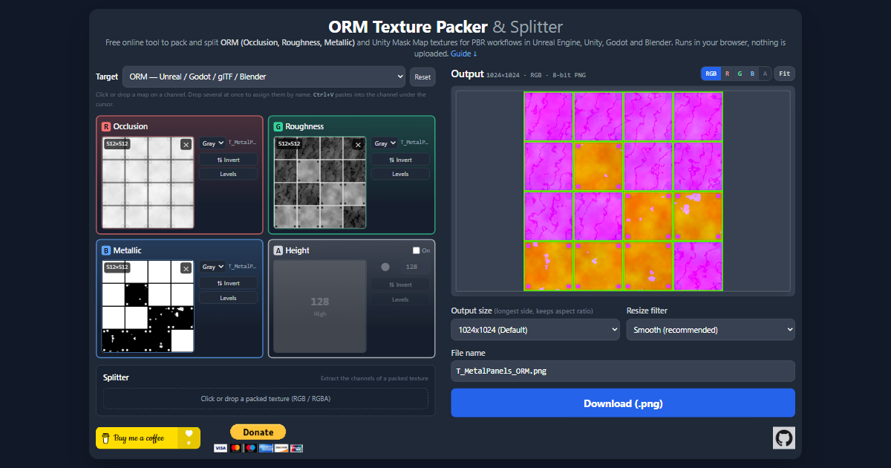

# 🔴🟢🔵 ORM Texture Packer & Splitter

**Free online tool to pack and split ORM (Occlusion, Roughness, Metallic) and Unity Mask Map textures, right in your browser.**

### 👉 [Open the tool: g-soos.github.io/ORM-Packer](https://g-soos.github.io/ORM-Packer/)

- ✅ Pack maps for **Unreal / Godot / glTF / Blender (ORM)**, **Unity HDRP Mask Map**, **Unity URP/Built-in Metallic-Smoothness** or a custom layout
- ✅ Drop all your maps at once: they are assigned by file name (`_AO`, `_Roughness`, `_Metallic`, `_Gloss`, `_Height`…)
- ✅ **Invert** and **Levels** on every channel (Roughness ↔ Smoothness is inverted automatically)
- ✅ Convert between formats (ORM ⇄ Mask Map) by switching the target
- ✅ Split any packed texture back into grayscale maps
- ✅ Lossless, pixel-exact PNG output, with optional alpha channel
- ✔️ 100% in-browser: your images are never uploaded

---

## ❓ What is an ORM texture?

An ORM texture stores three grayscale PBR maps in one image, one per color channel:

| Channel | Map | Meaning |
|---|---|---|
| 🔴 R | Ambient **O**cclusion | white = fully lit, dark = occluded |
| 🟢 G | **R**oughness | black = glossy, white = matte |
| 🔵 B | **M**etallic | white = metal, black = non-metal |

One texture instead of three means less memory and fewer texture samplers. It is the standard layout in Unreal Engine, Godot and glTF (Blender, Sketchfab, web). Unity uses its own packed layouts, which this tool also creates.

---

## 🎯 Targets

| Target | R | G | B | A |
|---|---|---|---|---|
| ORM: Unreal / Godot / glTF / Blender | Occlusion | Roughness | Metallic | optional Height |
| Unity HDRP: Mask Map | Metallic | Occlusion | Detail Mask | Smoothness |
| Unity URP / Built-in: Metallic | Metallic | — | — | Smoothness |
| Custom | any | any | any | any |

Switching the target re-routes the maps you already loaded, so a Roughness map moves to the Smoothness channel and is inverted automatically.

---

## 🚀 Features

### 🎨 Packer
- One color-coded square per channel showing exactly what goes into it (map or solid value, after adjustments)
- Load maps by clicking a square, drag & drop, dropping several files anywhere, or **Ctrl+V**
- No map? Use a solid value (0–255) with a hint of what it means (e.g. *0 · Dielectric*)
- Choose which part of the source image to read: Gray / R / G / B / A
- **Invert** and **Levels** (output min/max) on every channel
- Size badge per map, with a warning when sizes differ

### 🔧 Splitter
- Load any packed RGB/RGBA texture and get one grayscale map per channel
- Drag a channel onto the packer, or **Send all to packer** and change the target to convert formats
- Download all channels as a single `.zip`

### 📦 Output
- Size 64 → 8192 (longest side, aspect ratio kept) or Original
- Resize filter: Smooth (area average / bilinear) or Nearest
- Lossless 8-bit PNG, written pixel-exact (RGB, or RGBA with straight alpha)
- Preview RGB or each channel, zoom 1:1
- Automatic file name, e.g. `T_Rock_ORM.png`, `T_Rock_MaskMap.png`

---

## 🧩 How to use

1. Choose the **Target** for your engine
2. Drop your maps (or load them one by one / use solid values)
3. Adjust with Invert or Levels if needed, and check the preview
4. Pick the output size and **Download**

### Importing the texture

Packed textures are **data, not color**:

- **Unreal Engine:** uncheck sRGB, Compression Settings → `Masks (no sRGB)`
- **Unity:** uncheck sRGB (Color Texture). HDRP → *Mask Map* slot; URP/Built-in → *Metallic* slot with *Smoothness Source = Metallic Alpha*
- **Godot:** `ORMMaterial3D` → ORM slot
- **Blender:** Image Texture with Color Space **Non-Color** → *Separate Color* → G to Roughness, B to Metallic (R to the *glTF Material Output* Occlusion input when exporting glTF)

The tool includes a full guide and FAQ below the app.

---

## 🔒 Privacy

All processing happens locally in your browser with the Canvas API. Images never leave your computer. The site uses Google Analytics only for anonymous visit statistics.

---

## 🧠 Built with

HTML5 · Vanilla JavaScript · Canvas 2D API · TailwindCSS · GitHub Pages

A single static `index.html`, with no build step and no dependencies to install. To run it locally, open `index.html` in a browser.

---

## ☕ Support

The tool is free and ad-free. If it saves you time, you can support its development:

&nbsp;&nbsp;

---

## ✨ Author

**Gsoos** · Tools for 3D artists and developers.
